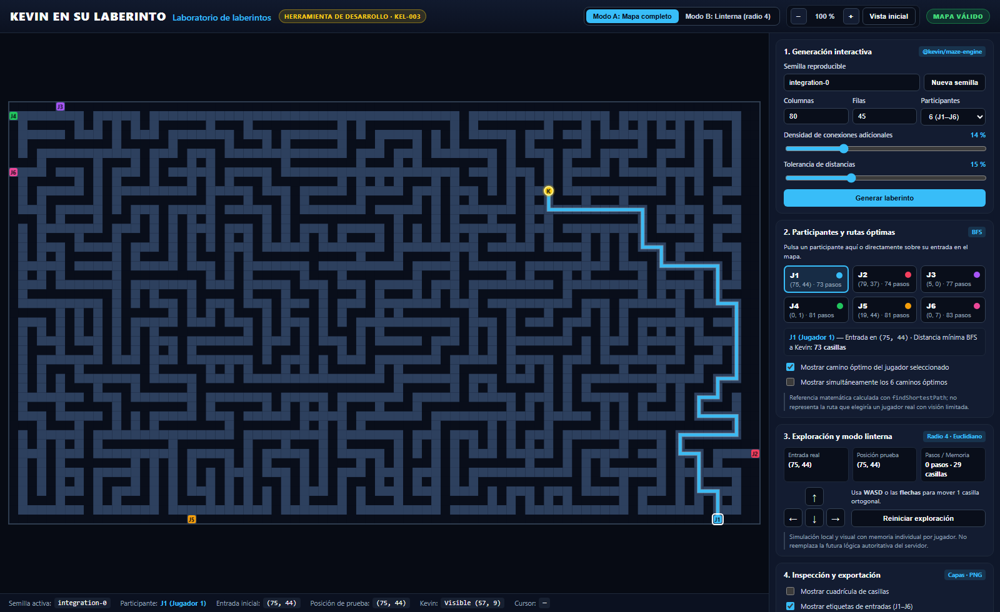

# Guía del laboratorio visual de laberintos (`KEL-003`)

El **Laboratorio de laberintos** (`apps/web`) es una herramienta interactiva de desarrollo y validación visual construida con **TypeScript estricto**, **Vite** y **Phaser 3**, conectada directamente al motor `@kevin/maze-engine`.

> **Nota importante:** Esta aplicación es un entorno de inspección técnica y prueba local. No es el videojuego multijugador final ni sustituye la lógica autoritativa del servidor.



---

## 1. Cómo iniciar la aplicación

Desde la raíz del monorepositorio:

1. Instala las dependencias:
   ```bash
   npm install
   ```
2. Inicia el servidor de desarrollo de Vite:
   ```bash
   npm run dev
   ```
3. Abre la dirección local indicada por Vite (por defecto `http://localhost:5173`).
4. Al cargar la página verás inmediatamente el laberinto predeterminado de **80 × 45** generado con la semilla `integration-0`, sus seis entradas (`J1`–`J6`), la ubicación de **Kevin (`K`)** y la ruta óptima del primer participante.

Para compilar la versión estática de producción:

```bash
npm run build
```

---

## 2. Cómo generar un laberinto

En la sección **1. Generación interactiva** del panel lateral puedes configurar:

- **Semilla reproducible:** texto que determina de forma exacta la topología, las entradas y la posición de Kevin (FNV-1a + mulberry32 en `@kevin/maze-engine`).
- **Botón `Nueva semilla`:** asigna automáticamente una semilla distinta de la actual y genera el nuevo laberinto.
- **Columnas y Filas:** dimensiones de la matriz (`>= 7` en cada eje; valor estándar `80 × 45`, proporción `16:9`).
- **Participantes:** cantidad de entradas entre `3` y `6` (`J1` a `J6`).
- **Densidad de conexiones adicionales:** porcentaje de paredes internas adicionales abiertas entre nodos lógicos vecinos (predeterminado `14 %`).
- **Tolerancia de distancias:** cota máxima permitida para `(máxima − mínima) / máxima` entre las distancias BFS desde las entradas hasta Kevin (predeterminado `15 %`).

La generación se ejecuta únicamente mediante una acción explícita al pulsar **Generar laberinto** (o **Nueva semilla**), utilizando directamente `generateMaze(config)`.

Si la configuración es inválida (`INVALID_CONFIG`) o se agotan los intentos sin hallar un candidato que cumpla las restricciones (`MAX_ATTEMPTS_EXHAUSTED`), se muestra un aviso de error con el código y los motivos devueltos por el motor, sin presentar un mapa inválido como aceptado.

---

## 3. Cómo seleccionar jugadores y observar rutas óptimas

En la sección **2. Participantes y rutas óptimas**:

- Puedes seleccionar cualquiera de los participantes (`J1`–`J6`) **pulsando su tarjeta en el panel lateral** o **haciendo clic directamente sobre su entrada en el lienzo del laberinto**.
- Al seleccionar un participante:
  - Se resalta su casilla de entrada en el mapa con un borde blanco.
  - Se informa su coordenada exacta `(columna, fila)` y su distancia mínima BFS hasta Kevin.
- Controles de rutas:
  - **Mostrar camino óptimo del jugador seleccionado:** traza el camino devuelto por `findShortestPath(maze, entrance, kevin)`.
  - **Mostrar simultáneamente los 6 caminos óptimos:** superpone las rutas óptimas de todos los participantes con sus colores distintivos y semitransparencia.

> **Advertencia sobre rutas óptimas:** El camino óptimo BFS es únicamente una referencia matemática para auditar equidad y topología; un participante humano con visión limitada no conoce esa ruta.

---

## 4. Cómo utilizar el modo linterna y mover al explorador

La barra superior permite alternar entre dos modos visuales:

- **Modo A: Mapa completo:** muestra la totalidad del laberinto, todas las entradas (`J1`–`J6`) y a Kevin (`K`).
- **Modo B: Linterna (radio 4):** simula la vista privada del participante seleccionado:
  - La linterna es **circular** con **radio inicial de 4 casillas** medido con **distancia euclidiana** ($\sqrt{\Delta x^2 + \Delta y^2} \le 4$).
  - **Sin oclusión por paredes:** las paredes dentro del círculo no bloquean la visión de las casillas situadas detrás si estas caen dentro del radio 4.
  - **Tres estados de iluminación:**
    1. **Oculto:** las casillas nunca exploradas por ese jugador permanecen cubiertas por niebla oscura.
    2. **Penumbra:** las casillas exploradas anteriormente pero fuera del círculo actual se muestran atenuadas.
    3. **Iluminado:** las casillas dentro del radio 4 actual se ven con brillo completo y un aro circular indicador.
  - **Visibilidad de Kevin (`K`):** en modo linterna, Kevin aparece **únicamente cuando su casilla está actualmente dentro del círculo iluminado**. Si su casilla fue descubierta antes pero queda en penumbra, el suelo se recuerda en penumbra pero `K` no se muestra.
  - **Privacidad de rivales:** en modo linterna no se muestran las entradas ni marcadores de los demás participantes.
  - **Memoria individual por jugador:** cada participante (`J1`–`J6`) conserva su propia memoria de casillas exploradas y su propia posición de prueba al alternar entre jugadores.

### Movimiento de prueba

En modo linterna puedes desplazar el marcador de prueba del participante seleccionado:

- **Teclado:** teclas **WASD** o **flechas de dirección** (`↑`, `↓`, `←`, `→`). Cada pulsación intenta avanzar exactamente **1 casilla ortogonal**. El visor bloquea el desplazamiento de la página con las flechas mientras el modo linterna está activo.
- **Controles en pantalla:** cruceta direccional en la sección **3. Exploración y modo linterna**.
- El movimiento no permite atravesar paredes ni salir de los límites del mapa.
- La **Posición de prueba** se mantiene visual y lógicamente diferenciada de la **Entrada inicial real** del mapa.
- Al llegar a la casilla de Kevin se muestra un aviso visual informativo de prueba, sin declarar ganador oficial.
- El botón **Reiniciar exploración** devuelve al participante seleccionado a su entrada inicial y restablece su memoria de exploración al círculo inicial.

---

## 5. Herramientas de inspección, cámara y exportación PNG

En la sección **4. Inspección y exportación** y en la barra superior:

- **Mostrar cuadrícula de casillas:** superpone la rejilla `cells[row][column]` sobre el terreno.
- **Mostrar etiquetas de entradas (`J1`–`J6`):** activa o desactiva los identificadores textuales sobre las entradas.
- **Mostrar puntos de articulación:** resalta las casillas de articulación detectadas por el motor.
- **Zoom y desplazamiento (pan):**
  - Usa la **rueda del ratón** sobre el mapa para acercar o alejar manteniendo el punto bajo el cursor, o los botones `+` y `−` de la barra superior.
  - Cuando el zoom es mayor a `100 %`, arrastra el lienzo con el ratón para desplazarte por el laberinto.
  - Pulsa **Vista inicial** para restablecer el encuadre completo al `100 %`.
- **Exportar PNG:**
  - Genera y descarga un archivo `.png` del laberinto completo a partir del mapa real activo, incluyendo paredes, corredores, entradas y Kevin.
  - La casilla **Incluir rutas activas al exportar PNG** permite elegir si los caminos óptimos visibles se dibujan también en la imagen descargada.

---

## 6. Qué representan las estadísticas

La sección **5. Estadísticas del laberinto** presenta directamente las métricas calculadas por `calculateMazeMetrics` y `validateMaze` en `@kevin/maze-engine`:

- **Validación del motor:** indica si el mapa cumple todas las invariantes geométricas, estructurales y de equilibrio.
- **Dimensiones y Semilla:** tamaño exacto `columnas × filas` y semilla reproducible.
- **Número de entradas y Coordenadas de Kevin:** posiciones en convención `(columna, fila)` con origen `(0, 0)` en la esquina superior izquierda.
- **Distancias BFS por entrada hacia Kevin:** gráfico comparativo y valores mínimo, medio y máximo en pasos ortogonales.
- **Diferencia relativa de distancias:** $\frac{\text{máxima} - \text{mínima}}{\text{máxima}}$, comparada contra la tolerancia configurada (por defecto `15 %`).
- **Porcentaje de suelo transitable:** proporción de casillas `"floor"` respecto del total de la matriz.
- **Callejones sin salida (`deadEnds`):** casillas transitables de grado 1.
- **Bifurcaciones (`junctions`):** casillas transitables de grado $\ge 3$.
- **Ciclos independientes (`independentCycles`):** $E - V + C$, cantidad de bucles alternativos en el grafo del laberinto.
- **Puntos de articulación (`articulationPoints`):** casillas cuya eliminación incrementa el número de componentes conexas.
- **Cuello de botella común (`hasSharedBottleneck`):** indica si existe alguna casilla distinta de Kevin cuya eliminación desconectaría simultáneamente todas las entradas respecto de Kevin.

---

## 7. Limitaciones conocidas de la simulación visual

1. **Herramienta local de desarrollo:** toda la simulación de linterna y movimiento se ejecuta en el navegador con fines de inspección. En el juego real, el servidor autoritativo (`ADR-002` y `ADR-007`) validará movimientos, tiempos, colisiones y visibilidad.
2. **Sin cadencia competitiva ni temporizador:** el movimiento manual responde pulsación a pulsación sin aplicar el intervalo competitivo de 150 ms ni el reloj de partida de 240 s.
3. **Exploración individual por turno de inspección:** se simula un participante activo a la vez al inspeccionar la linterna, sin conexiones WebSocket ni múltiples clientes simultáneos.
